# IndiaKart E-Commerce Analytics

End-to-end analytics project on a 24-month Indian online marketplace dataset: data cleaning, exploratory analysis, business KPIs, and a 5-page interactive Power BI dashboard, built to answer management's questions on revenue, cancellations, returns, customers, and operations.


https://github.com/user-attachments/assets/a1a8f443-83ef-465f-99a1-23a031b9a0ba

---

## Table of Contents

1. [Project Overview](#1-project-overview)
2. [Objectives](#2-objectives)
3. [Business Questions](#3-business-questions)
4. [Dataset](#4-dataset)
5. [Tools and Technologies](#5-tools-and-technologies)
6. [Workflow and Methodology](#6-workflow-and-methodology)
7. [Data Cleaning and Preprocessing](#7-data-cleaning-and-preprocessing)
8. [Exploratory Data Analysis](#8-exploratory-data-analysis)
9. [Key Performance Indicators](#9-key-performance-indicators)
10. [Power BI Dashboard](#10-power-bi-dashboard)
11. [Key Findings](#11-key-findings)
12. [Business Recommendations](#12-business-recommendations)
13. [Repository Structure](#13-repository-structure)
14. [Viewing the Power BI Dashboard](#15-viewing-the-power-bi-dashboard)
15. [Limitations and Future Improvements](#16-limitations-and-future-improvements)
16. [Skills Demonstrated](#17-skills-demonstrated)
17. [Author](#18-author)

---

## 1. Project Overview

IndiaKart is a fast-growing Indian online marketplace selling across 10 categories (Electronics, Fashion, Home & Kitchen, Books, Beauty & Health, Sports & Fitness, Toys & Baby, Grocery, Automotive, Office Supplies). It accepts multiple payment methods (UPI, Credit Card, Debit Card, COD, EMI, Net Banking, Wallet) and delivers through 7 logistics partners.

**Business problem:** management needs data-driven answers on which categories drive revenue, how many orders are lost to cancellations and returns, which customers are most valuable, and where operational risks sit. This project takes the raw data from messy tables to a management-ready dashboard.

The dataset covers **June 2023 to June 2025** (data ends 23 June 2025) across **8 related tables**.

## 2. Objectives

- Assess data quality (completeness, uniqueness, validity, referential integrity) before analysis.
- Explore demand, revenue, customer, payment, and return patterns with 10 EDA charts.
- Calculate 10 business KPIs against management benchmarks.
- Deliver a 5-page interactive Power BI dashboard with slicers.
- Translate findings into actionable business recommendations.

## 3. Business Questions

| # | Question |
|---|----------|
| 1 | Which product categories drive the most revenue, and which underperform? |
| 2 | Are too many orders lost to cancellations? |
| 3 | Which customer segments are most valuable? |
| 4 | Are there clear seasonal patterns (e.g. Diwali) to plan inventory around? |
| 5 | Which states and cities are the biggest markets? |
| 6 | Is the return rate healthy, or do certain products or reasons dominate? |

## 4. Dataset

Eight CSV tables from the IndiaKart database.

| Table | Records (per project brief) | Description |
|-------|---------------------------:|-------------|
| `orders` | 50,000 | Every order placed (central table) |
| `order_items` | 100,000 | Individual products within each order |
| `customers` | 10,000 | Customer profiles and lifetime stats |
| `products` | 1,000 | Product catalogue with pricing and GST |
| `payments` | 50,000 | Payment transactions and gateway details |
| `returns` | 10,000 | Return requests with reasons and refund status |
| `inventory` | 1,000 | Warehouse stock levels and reorder alerts |
| `suppliers` | 200 | Supplier details and ratings |

**Key columns used**

| Table | Columns |
|-------|---------|
| `orders` | `order_id`, `customer_id`, `order_date` (DD-MM-YYYY), `delivered_date`, `status` (Delivered / Shipped / Processing / Cancelled / Returned), `final_amount`, `gst_amount`, `payment_method`, `channel`, `state` |
| `customers` | `customer_id`, `segment` (Premium / Regular / Budget / New / Inactive), `city`, `state`, `total_orders`, `total_spent`, `registration_date` |
| `order_items` | `item_id`, `order_id`, `product_id`, `category`, `quantity`, `unit_price`, `total_price` |
| `inventory` | `product_id`, `qty_available`, `reorder_level`, `reorder_qty`, `warehouse_location`, `status` |

> The raw CSV files are not included in this repository.

## 5. Tools and Technologies

| Area | Tools |
|------|-------|
| Data cleaning and EDA | Python: Pandas, NumPy, Matplotlib |
| Dashboard | Power BI Desktop |
| Version control | GitHub |

## 6. Workflow and Methodology

The project ran in four sequential phases, each building on the last.

| Phase | Deliverable | Focus |
|-------|-------------|-------|
| 1 | Data cleaning and quality report | Profiling, missing values, duplicates, types, outliers, referential integrity |
| 2 | EDA with 10 charts | Trends, distributions, segments, payments, returns |
| 3 | KPI calculations | 10 KPIs with formulas, benchmarks, and interpretation |
| 4 | Dashboard and insights | Power BI report |

## 7. Data Cleaning and Preprocessing

Report: [Phase 1 Data Quality Report](reports/IndiaKart_Data_Quality_Report_Phase1_DataCleaning_Bindiya_Anand.pdf)

**Treatments applied**

- Converted date columns to datetime: `order_date`, `delivered_date`, `registration_date`, `last_login_date`, `launch_date`, `payment_date`, `return_date`, `refund_date`, `last_restocked_date`, `created_date`.
- Parsed `order_time` and `payment_time` into time objects.
- Profiled missing values, duplicate keys, and repeated order/product combinations.
- Validated relationships between tables and delivery-date logic.
- Flagged anomalies (orders above ₹5 lakh, one incomplete payment record) instead of deleting them. No records were deleted, imputed, or corrected.

**Checks and outcomes**

| Check | Outcome |
|-------|---------|
| Duplicate `order_id` in orders | None found |
| `delivered_date` earlier than `order_date` | None found (0 invalid) |
| Tracking ID linked to multiple orders | None found |
| Blank `delivered_date` | Expected: orders not yet delivered, cancelled, or incomplete; treated as meaningful |
| Order items with repeated `order_id` + `product_id` | 103 combinations (206 records); repeated lines differ in quantity and amounts, so may be separate line items |
| Customers with `total_orders = 0` | 457; registered customers with no orders, not treated as an error |
| Out-of-stock products | 2; all inventory `product_id`s exist in products |
| Incomplete payment record | 1 record blank in every field except `payment_id` |

## 8. Exploratory Data Analysis

Report: [Phase 2 EDA Report](reports/IndiaKart_Phase2_EDA_Bindiya_Anand.pdf)

| # | Analysis | Observation |
|---|----------|-------------|
| 1 | Monthly order volume | Stable at roughly 1,900-2,200 orders/month; peak of 2,239 in January 2025; no clear Diwali spike |
| 2 | Monthly GMV, year-over-year | Roughly ₹12-14 crore in full months; peak about ₹13.79 crore (Jan 2025); mixed YoY performance |
| 3 | Category revenue share | Electronics about 56.6%, Sports & Fitness 17.7%; the two together about 74.2% |
| 4 | Order status distribution | Delivered 65.0%, Cancelled 12.0%, Shipped 10.1%, Returned 7.9%, Processing 5.0% |
| 5 | Top 10 states by orders | Uttar Pradesh (9,507) and Maharashtra (8,179) lead, about 35.4% of all orders combined |
| 6 | Customer segment distribution | Regular 40.26%, Budget 25.05%, Premium 15.01%, New 14.88%, Inactive 4.80% |
| 7 | Payment method usage | UPI 35.14%, Credit Card 20.01%, Debit Card 15.25%; Wallet lowest at 3.89% |
| 8 | Age distribution | Ages 18-65, mean about 41.7, median 42; middle 50% between 30 and 54 |
| 9 | Return reasons | Size Issue (1,196), Changed Mind (1,150), Damaged in Transit (1,143); spread across many reasons |
| 10 | AOV by segment | Budget highest (about ₹64,951); Premium lowest (about ₹61,692) |

<details>
<summary><b>EDA Visualizations</b></summary>
  
**Monthly Order Volume**

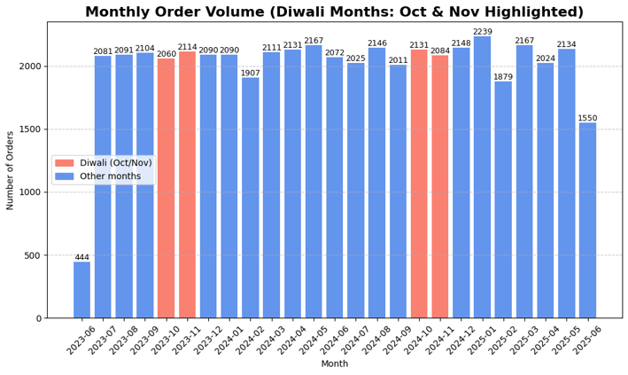

**Gross Merchandise Value**

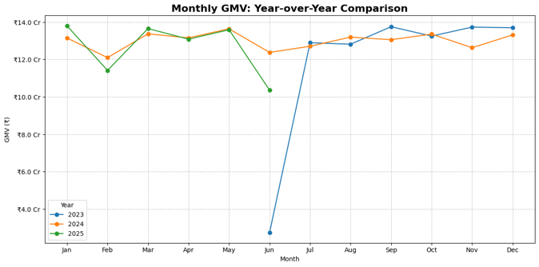

**Category-wise Revenue Share**

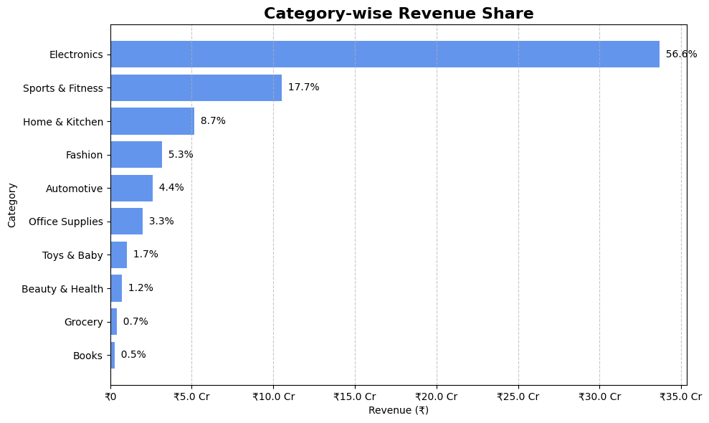

**Order Status Distribution**

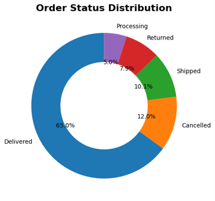

**Top 10 States by Orders**

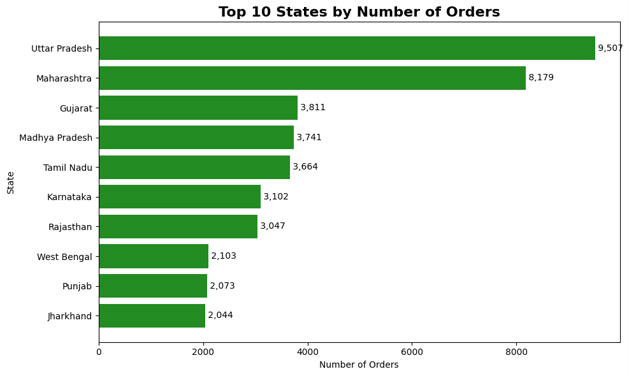

**Customer Segment Distribution**

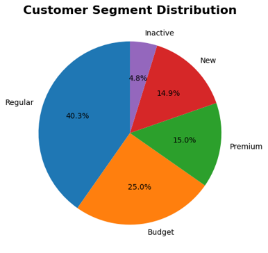

**Payment Method Usage**

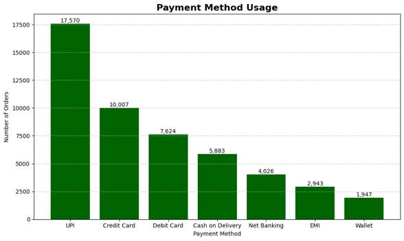

**Age Distribution**

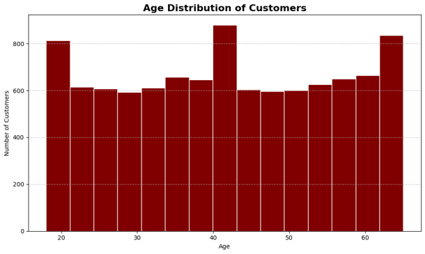

**Return Reasons**

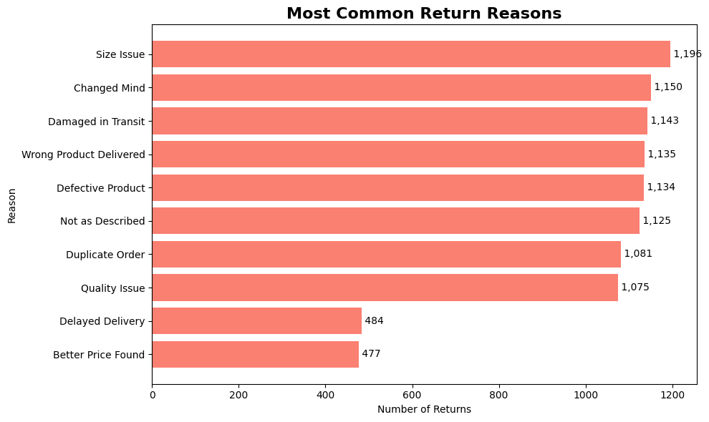

**Average Order Value**

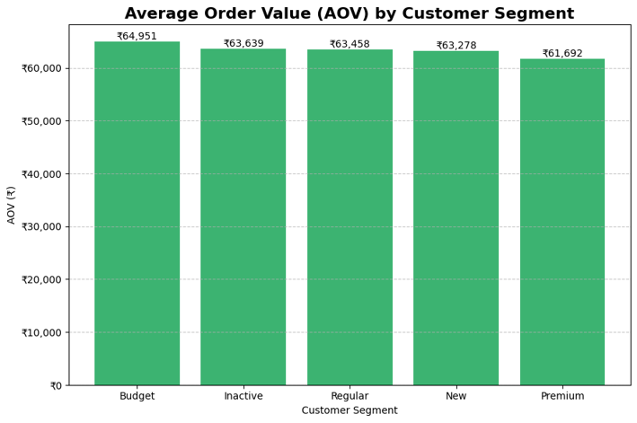

</details>

## 9. Key Performance Indicators

Report: [Phase 3 KPI Report](reports/IndiaKart_Phase3_KPI_Bindiya_Anand.pdf)

| # | KPI | Definition | Result | Benchmark | Status |
|---|-----|------------|--------|-----------|--------|
| 1 | Gross Merchandise Value (GMV) | Sum of `final_amount`, all statuses | ₹3,147,385,545 | None | Informational |
| 2 | Net Revenue | Sum of `final_amount` where status = Delivered | ₹2,053,858,612 (32,499 delivered orders) | None | Informational |
| 3 | Average Order Value (AOV) | Net Revenue ÷ delivered orders | ₹63,198 | None | Informational |
| 4 | Cancellation Rate | Cancelled ÷ total orders × 100 | 11.99% (5,996 of 50,000) | < 10% | Not met |
| 5 | Return Rate | Return records ÷ delivered orders × 100 | 30.77% (10,000 ÷ 32,499) | < 8% | Not met |
| 6 | Customer Lifetime Value | Average `total_spent` per segment | Premium ₹532,735 vs Regular ₹361,871 (1.47x) | Premium about 3x Regular | Not met |
| 7 | Month-over-Month Growth | (This month GMV − last month GMV) ÷ last month GMV × 100 | June 2025: −23.74% (partial month) | None | Informational |
| 8 | Top Category Revenue Share | Category revenue ÷ total revenue × 100 | Electronics 57.41% (₹1,642,422,813) | Risk if > 60% | Met |
| 9 | Payment Failure Rate | Failed ÷ total payments × 100 | 3.50% (1,748 of 50,000) | < 2% | Not met |
| 10 | Inventory Fill Rate | In Stock SKUs ÷ total SKUs × 100 | 92.20% (922 of 1,000) | > 95% | Not met |

**Average lifetime spend by segment (KPI 6)**

| Segment | Average `total_spent` | Index vs Regular |
|---------|----------------------:|-----------------:|
| Premium | ₹532,735 | 1.47x |
| Regular | ₹361,871 | 1.00x |
| New | ₹274,866 | 0.76x |
| Budget | ₹186,179 | 0.51x |
| Inactive | ₹32,249 | 0.09x |

**Notes on interpretation**

- **Return rate:** only 3,933 orders carry the status "Returned", fewer than the 10,000 return records, and the denominator counts Delivered orders only. The 30.77% figure signals a likely problem but its size is uncertain until the definition is reconciled.
- **MoM growth:** June 2023 (data starts 24 June) and June 2025 (data ends 23 June) are partial months. Over the 22 complete months from August 2023 to May 2025, average growth is 0.51%, which indicates a flat but volatile trend.
- **CLV** here is average recorded lifetime spend, not a predictive model.

## 10. Power BI Dashboard

File: `IndiaKart_Phase4_Dashboard_Bindiya_Anand.pbit` (data model tables: customers, inventory, order_items, orders, payments, products, returns).

| Page | Visuals | Slicers |
|------|---------|---------|
| **1. Revenue Overview** | KPI cards (Total Orders 50K, GMV ₹3.15bn, AOV ₹62.95K, Cancellation Rate 11.99%), Net Revenue by year, Monthly GMV trend | Year |
| **2. Category Performance** | Revenue by category, Top 10 products by revenue, Estimated return rate by category | Category |
| **3. Customer Insights** | Top 10 states by orders, Customers by segment (donut), Monthly customer acquisitions | Segment, Year |
| **4. Operations** | Payment method breakdown, Order status funnel, Return reason analysis | Order Year |
| **5. Inventory Alert** | Low-stock products table (qty available, reorder level, reorder qty, warehouse), Stock status summary, Warehouse distribution | Stock Status |

<details>
<summary><b>Dashboard screenshots</b></summary>

**Revenue Overview**
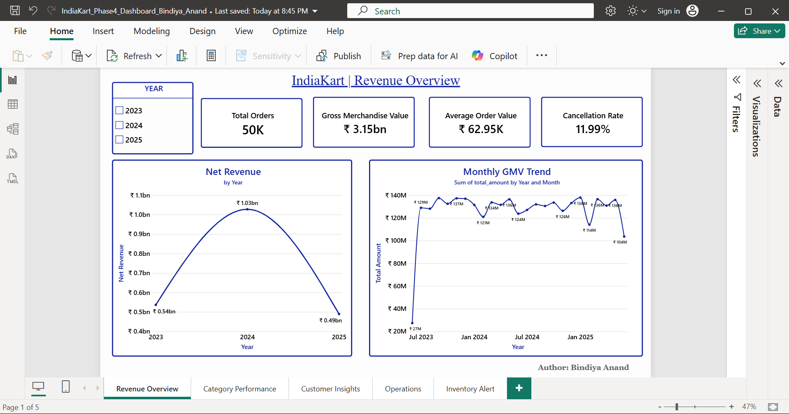

**Category Performance**
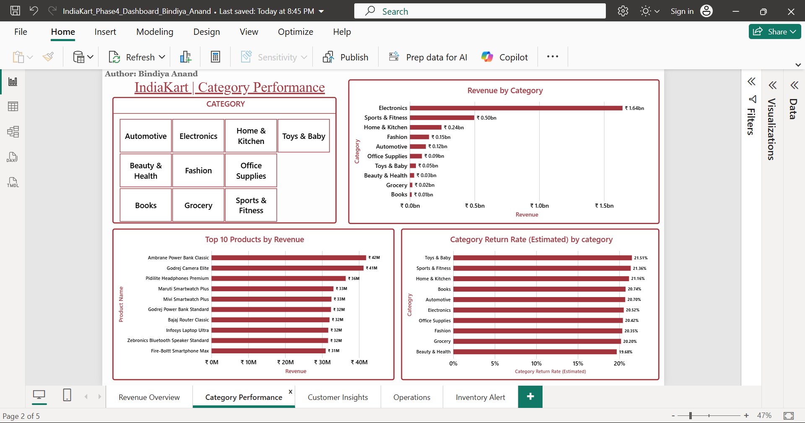

**Customer Insights**
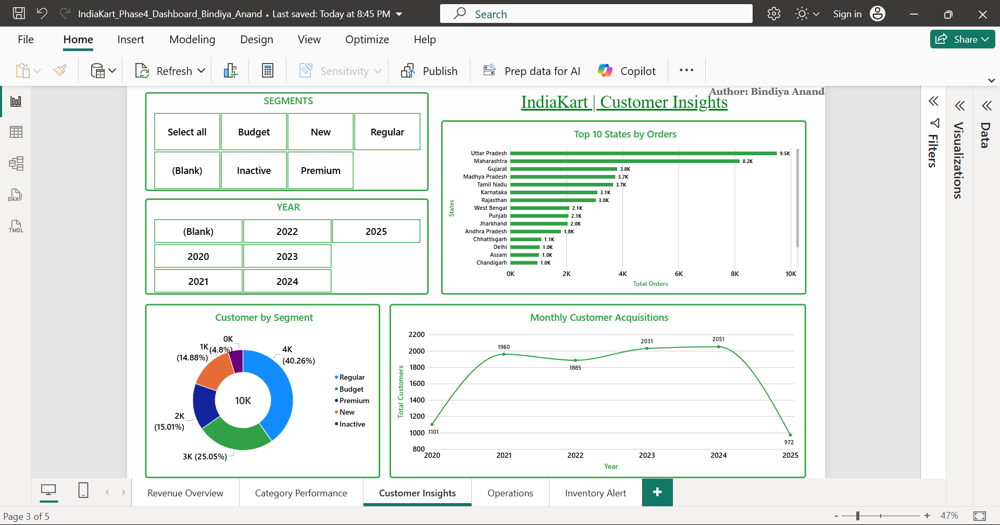

**Operations**
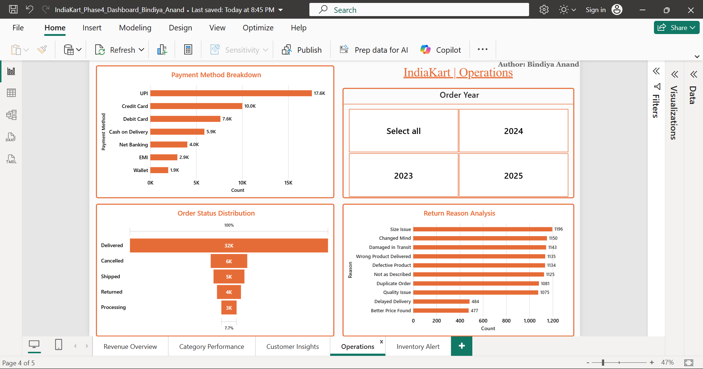

**Inventory Alert**
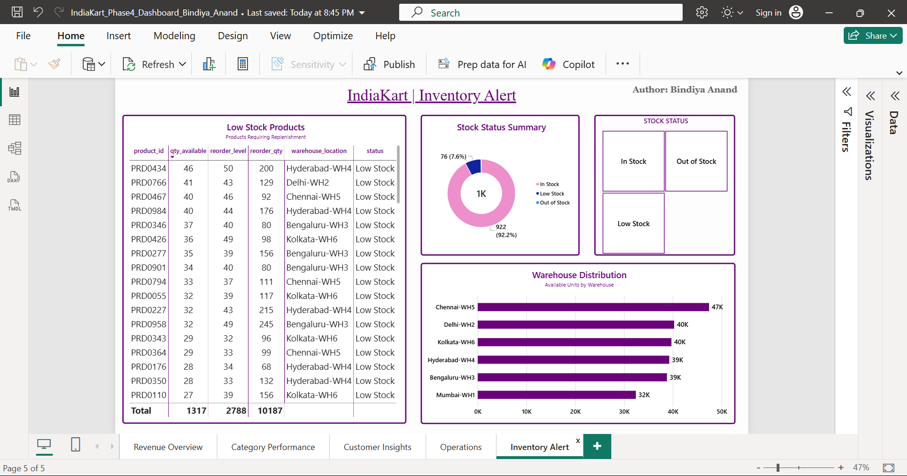

</details>

## 11. Key Findings

1. **Only about two-thirds of order value becomes delivered revenue.** Net Revenue is ₹2.05bn against GMV of ₹3.15bn (65.3%). 11.99% of orders are cancelled and a further 3,933 are marked Returned.
2. **Returns look like the largest operational gap, but the metric needs validation.** The 30.77% return rate is far above the 8% target, yet the numerator and denominator are not defined on the same basis. Return reasons are spread across several causes (Size Issue, Changed Mind, Damaged in Transit lead at about 11-12% each).
3. **Customer value is less differentiated than expected.** Premium customers spend 1.47x Regular against a 3x benchmark, Premium has the lowest AOV of the five segments, and Inactive customers average only ₹32,249 lifetime spend.
4. **Revenue is concentrated in Electronics.** Electronics contributes 57.41% of revenue, just under the 60% risk threshold; Sports & Fitness is next at 17.38%.
5. **No strong Diwali effect in order volume.** October and November are not consistently the highest-volume months; monthly volume is broadly flat, and complete-month growth averages 0.51%.
6. **Geographic concentration.** Uttar Pradesh and Maharashtra together account for about 35.4% of orders.
7. **Payment and stock KPIs miss target.** Payment failure is 3.50% (target < 2%) and inventory fill rate is 92.20% (target > 95%), driven mainly by 76 Low Stock SKUs rather than the 2 Out of Stock SKUs.

## 12. Business Recommendations

These follow from the findings above; each needs the validation noted before action.

1. **Reconcile the return definition, then analyse returns by category and reason.** Align the numerator and denominator, then target preventable causes (sizing information, product descriptions, packaging and transit handling).
2. **Break down cancellations** by category, payment method, order stage, and period, and test whether they are linked to the 3.50% payment failures.
3. **Reduce payment failures** by analysing failures by gateway, bank, and payment method to find where they concentrate.
4. **Replenish Low Stock SKUs first**, starting with high-selling Electronics items, to bring fill rate above 95%.
5. **Manage Electronics concentration risk** by growing smaller categories while protecting the leading ones.
6. **Plan campaigns from observed demand** rather than assuming a Diwali peak; use complete-month history.
7. **Review segment definitions and re-engage Inactive customers**, given the weak Premium-to-Regular separation and very low Inactive spend.
8. **Prioritise delivery capacity and support in Uttar Pradesh and Maharashtra**, while checking profitability and customer value by state.

## 13. Repository Structure

Folders marked *(add)* are not yet populated from the files reviewed.

```
IndiaKart-Ecommerce-Analytics/
├── README.md
├── Notebooks/
│   ├── Phase1_DataCleaning_Bindiya_Anand.ipynb
│   ├── Phase2_EDA_Bindiya_Anand.ipynb
│   └── Phase3_KPI_Bindiya_Anand.ipynb
├── Power_BI_Dashboard/
│   └── IndiaKart_Phase4_Dashboard_Bindiya_Anand.pbit
├── images/
│   └── dashboard/
│       ├── 01_revenue_overview.png
│       ├── 02_category_performance.png
│       ├── 03_customer_insights.png
│       ├── 04_operations.png
│       └── 05_inventory_alert.png
│   └── plots/
│       ├── 01_monthly_order_volume.png
│       ├── 02_gmv.png
│       ├── 03_category_revenue_share.png
│       ├── 04_order_status_distribution.png
│       ├── 05_top_states.png
│       ├── 06_customer_segment.png
│       ├── 07_payment_method.png
│       ├── 08_age_distribution.png
│       ├── 09_return_reasons.png
│       └── 10_aov.png
├── reports/
│   ├── IndiaKart_Data_Quality_Report_Phase1_DataCleaning_Bindiya_Anand.pdf
│   ├── IndiaKart_Phase2_EDA_Bindiya_Anand.pdf
│   ├── IndiaKart_Phase3_KPI_Bindiya_Anand.pdf
│   └── IndiaKart_Phase4_Management_Summary_Report_Bindiya_Anand.pdf
└──
```

## 14. Viewing the Power BI Dashboard

- **Quick view:** see the video preview at the top or screenshots in [Section 10](#10-power-bi-dashboard)
- **Interactive view:** download the `.pbit` file from `Power_BI_Dashboard/` and open it in the free [Power BI Desktop](https://www.microsoft.com/en-in/power-bi). Use the slicers on each page to filter.

## 15. Limitations and Future Improvements

**Limitations**

- **Row counts differ across phases.** The Phase 1 report profiled Orders at 6,543 rows and Payments at 18,930 rows, while the project brief and the Phase 2-3 analysis use 50,000 each. The Phase 1 referential-integrity counts (order items, payments, and returns not found in Orders) reflect that smaller load and should be re-run on the full files before being cited.
- **Return rate definition** mixes return records with a Delivered-only base (see [Section 9](#9-key-performance-indicators)). The dashboard's category return rate is labelled "Estimated" (about 19.6-21.5% across categories).
- **AOV differs between report and dashboard.** The KPI AOV (₹63,198) is Net Revenue ÷ delivered orders; the dashboard card (₹62.95K) equals GMV ÷ all 50,000 orders.
- **Electronics share differs slightly by method:** about 56.6% in the EDA chart vs 57.41% in the KPI calculation (`order_items.total_price`).
- **Partial months** at both ends of the data (June 2023 and June 2025) distort month-over-month and year-over-year comparisons.
- **CLV** is historical average spend, not predictive. No seasonality, profitability, or cost data was analysed.
- 52 orders above ₹5 lakh (maximum ₹9.43 lakh) were flagged but kept, and may skew averages.

**Potential improvements**

- Reconcile table row counts and rerun referential-integrity checks.
- Restate MoM and YoY growth on complete months only.
- Add value split across non-delivered statuses to locate the largest revenue leakage.
- Break down cancellations and payment failures by gateway, bank, category, and payment method.
- Predictive CLV and churn modelling.

## 16. Skills Demonstrated

- **Data cleaning:** type conversion, missing-value and duplicate profiling, outlier flagging, referential-integrity validation
- **EDA:** time-series, distribution, and segment analysis with Matplotlib and Seaborn
- **Business metrics:** KPI definition, benchmark comparison, critical interpretation (partial months, metric-definition issues)
- **Dashboarding:** multi-page Power BI report with slicers and KPI cards
- **Communication:** translating analysis into business findings and recommendations

## 17. Author

**Bindiya Anand**
Data Analyst Intern

- GitHub: https://github.com/Bindiya-Anand
- LinkedIn: https://www.linkedin.com/in/bindiya-anand/
